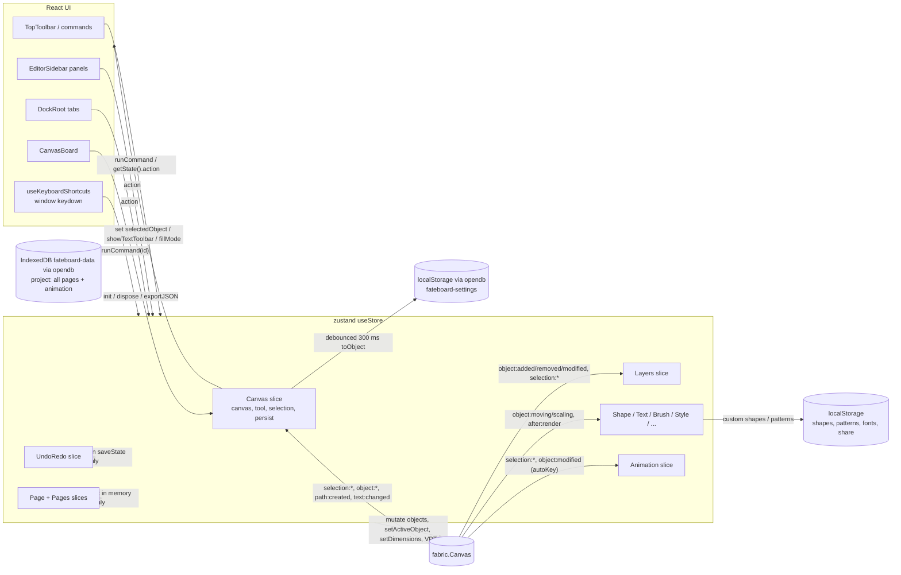

# Architecture

## Stack (from `package.json` + `node_modules`, 2026-11-06)

| Concern | Library | Installed |
|---|---|---|
| UI | React 19 (`StrictMode`), react-router-dom 7 (`BrowserRouter`) | 19.2.x / 7.7.x |
| Canvas | **Fabric.js 7.1.0** (docs/code comments still say v6) | 7.1.0 |
| State | zustand 5 (`devtools` middleware) | 5.0.11 |
| Persistence | One storage layer, `@/lib/storage` (see "Storage layer"): projects in IndexedDB, settings and small libraries in localStorage | opendb-store 3.0.0 |
| Styling | Tailwind CSS 4 (`@tailwindcss/vite`), Font Awesome 7, lucide-react | |
| Geometry | paper.js (boolean ops, geometry engine) | 0.12.x |
| Export | mp4-muxer (WebCodecs MP4); PNG / SVG / JSON via Fabric | |
| Build | Vite 7, TypeScript 5.9 (`strict: false`), ESLint 9 flat config, Prettier 3 | |
| Test | Vitest 4 + jsdom + Testing Library | |
| Unused deps | `@reduxjs/toolkit`, `react-redux` (dead file only), `json-server` (no `db.json`) | |

Node: `.nvmrc` = v26.13.0. Deploy: GitHub Pages via `.github/workflows/ci.yml` → reusable `_deploy.yml` ( push to `main` only, `actions/deploy-pages` into the `github-pages` environment; the custom domain is set in repo Settings > Pages, not by a `CNAME` file).

## Layers

```
src/main.tsx (preloadRoute) → App.tsx → app/rootRouter.tsx (BrowserRouter + RouteSeo; renders app/routes/appRoutes.tsx)
  ├─ templates/SiteLayout   (ErrorBoundary only; no store, no Fabric: BUG-209)
  │    ├─ /                 pages/web/WhiteboardMarketingSite   (marketing; has its own MiniWhiteboard)
  │    ├─ /gallery          pages/Gallery/GalleryPage           (all gallery pieces; was a landing section)
  │    └─ /gallery/:id      pages/GalleryTutorial/GalleryTutorialPage
  ├─ ErrorBoundary → templates/RootLayout (LAZY chunk: store + Fabric; applies Fabric selection chrome; hydrates
  │    settings from `settingsStorage`, then renders <Outlet/> inside ErrorBoundary; DialogHost + ToastHost)
  │    ├─ /draw             pages/Editor/Editor.tsx             ← the editor
  │    ├─ /setting          pages/Setting/EditorSettingPage     (Preferences)
  │    ├─ /command-palette  pages/Command/CommandPalette
  │    └─ /help             pages/HelpPage/HelpPage
  └─ * → pages/NotFound/NotFoundPage
```

Editor composition (`Editor.template.tsx` grid):

```
┌ header: organisms/header/ui/Header → TopToolbar (File, Edit, Align, Group, Lock, Zoom, Origin, Extra) + ShapeToolsHeader
├ leftSidebar: editorsidebar/ui/EditorSidebar (rail + panel; items from editorsidebar.config.tsx)
├ canvasBoard: board/ui/CanvasBoard  (mode 'design' | 'whiteboard', rulers, artboard, floating text toolbar)
├ rightPanel: DockRoot (color picker + TabsRail: Tiling, Rotate, Along Path, Filter, Export, Animate)
└ footer: footer/ui/Footer → FullScreen + StrokeControls
+ ContextMenu (store-driven)
```

Code layers (top depends on bottom):

1. **Routes/pages**: `src/app`, `src/components/pages`
2. **Templates/organisms/molecules/atoms** (atomic design): `src/components/**`. Organisms read/write the store.
3. **Config**: `src/components/config` (toolbar button configs that double as **commands** with shortcuts).
4. **Store**: `src/store` (one zustand store, 23 slices). This is the only layer that should mutate Fabric objects
   (today some components do it directly, e.g. CanvasBoard, Editor, panels).
5. **Domain libs**: `src/animation` (engine + export), `src/lib` (patterns, path repeat, connectors, text-in-shape,
   gradient tool, boolean engine), `src/hooks/shape` (shape catalog), `src/feature/import`.
6. **Fabric.js** (single `fabric.Canvas` per editor).

## Canvas ownership

- **Owner:** `createCanvasSlice` stores the instance in `useStore.getState().canvas`. Created by `init(el, container)`,
  destroyed by `dispose()`.
- **Mounting:** `CanvasBoard` → `CanvasSurface` creates a `<canvas>` element **in code** (not JSX; Fabric wraps it),
  calls `init`, and on unmount calls `dispose()` (which flushes the autosave). `CanvasSurface` is keyed by mode, so a
  mode change remounts it; the new `init()` restores the autosaved project (one loader, BUG-016).
- **Readers:** almost every organism reads `canvas` from the store and calls Fabric directly. There is no facade.
- **Other Fabric canvases:** `MiniWhiteboard` (marketing), `advanceOperationSlice`
  (`StaticCanvas` for pattern tiles). `advanceOperationSlice.setCanvas` can overwrite the store's `canvas` (unused).
- **Geometry has one owner per board** (Q2, BUG-007 fixed): `CanvasBoard` sizes the canvas (design: backstore = page
  px from `selectedPreset`, CSS = fit × zoom, identity viewport; whiteboard: host size). Zoom / pan go through the Page
  slice (`setZoom`, `zoomToRect`, `applyPageSize`); in design they change only `zoom`. See CANVAS.md "Zoom / pan".

## How slices compose

`src/store/index.ts`:

```ts
export const combinedSlice = (set, get, store) => ({
  ...createCanvasSlice(set, get, store),
  ...createBrushSlice(set, get, store),
  // … 22 more, createPageSlice twice …
  ...createAnimationSlice(set, get, store),
});
export const useStore = create(devtools(combinedSlice, { name: 'DesignEditorStore', enabled: isDev }));
```

Rules that actually hold today:
- Every slice receives the **same** `set/get/store`. Cross-slice calls use `get().otherAction?.()`.
- Later spreads silently override earlier keys (17 colliding keys). See STATE.md.
- Slices with private runtime state keep it in **closure variables** (Canvas: `persistLock`, timers; UndoRedo: timer;
  Animation: module-level `rafId`). Module-level state is shared across store instances, which matters for tests.
- `createNotebookSlice` uses `store.subscribe` to re-attach to new canvases. That is the only slice that uses the
  third argument.

## Data flow



Event flow, step by step:

1. **User input on canvas** → Fabric fires events → `registerCanvasEvents` handlers in the Canvas slice:
   `selection:created/updated` → `handleSelectionChange` (toolbar state, `updateFromFabric`, `saveState`);
   `selection:cleared` → `handleSelectionClear`; `object:modified` → `handleObjectChange` (linked clones + `persist`);
   `object:added/removed`, `path:created`, `text:changed` → `handlePersistEvent` → `persist()` (300 ms debounce →
   Pages `captureProject()` → `projectStorage.save(project)` in IndexedDB; page-only changes and track edits call
   `persist()` too).
2. Other listeners added by slices/panels: Layers `bindLayerEvents` (resync layers on rAF), Shape
   `installShapeBehavior` (text-in-shape scaling, connectors, shape text toolbar), Notebook (snap + grid), Brush hooks,
   Animation `bindAutoKey`, PagePanel (500 ms `saveCurrentPage`), CanvasBoard (context menu, offset refresh, grid,
   floating toolbar position).
3. **UI → canvas**: components call store actions, which mutate Fabric objects and `requestRenderAll()`, and usually
   call `saveState()`. Some components mutate Fabric directly (e.g. `CanvasBoard` floating toolbar `onChange`,
   `Editor.tsx` brush effect).
4. **Keyboard**: `useKeyboardShortcuts` (mounted by CanvasBoard) matches `commands[].shortcut` and calls
   `runCommand(id)`. Panels add their own window/element listeners (Animation, Draw `[ ]`, Pages PageUp/Down,
   ExtraBar grid/snap, NodeEditor).

## Save / load

| Flow | Entry | Format | Notes |
|---|---|---|---|
| Autosave | `persist()` | the whole project (`captureProject`: every page + its animation; live canvas → current page; `serializeCanvas`, animated objects at rest) → IndexedDB key `project` | Locked (`persistLock`) during import/clear/restore; skipped while a page loads (BUG-004) |
| Restore | `init` → `restoreFromStorage()` → `importProject(project)` (all pages, the page that was open) → `initPages()` (no-op when pages exist) | same | Skips if objects already exist; when nothing was saved, a change made during the read (its save skipped under the lock) is saved once the read ends (BUG-186). An old localStorage `drawJson` board is loaded with `importJSON` and adopted as Page 1, then removed on the first save. A saved board that cannot be opened is copied to the key `project.unreadable` and offered as a download; the editor starts empty (BUG-154). A saved board that cannot be **read** (storage blocked or failing) is never written over: autosave and New board's clear stop until a later read works, and a dialog says so (BUG-173). A failed autosave opens one "Save a copy" dialog (BUG-162) |
| Save file | FileBar → `saveBoard()` | downloads `drawing.fateboard` (the whole project, same format as the autosave) | |
| Open file | FileBar "Open" button → hidden `<input>` → `feature/import/importFile` | `.png/.jpg/.webp` → image, `.svg` → SVG, `.fateboard/.json`: a project → `importProject`; a single board → `importFabricJSON` → store `importJSON(json, { undoable: true })` (persist lock, autosave, one undo step; a broken file shows a dialog) | A project opens on the first page that loads; when no page loads the open board stays as it is and a dialog says so (BUG-154). An SVG or image that cannot be read shows a dialog (BUG-158). Thumbnails and page sizes from a file are checked (BUG-157) |
| Project | `exportProject()` / `importProject()` (Save / Open in the top bar) | `{app:'fateboard', version:1, currentPageId, pages[{…, animation?}]}` | Same document is autosaved (BUG-004) |
| Share | removed until there is a backend (decision Q6, BUG-028) | | The link only ever worked in the same browser; Save Board (`.fateboard`) is the way to hand a board over |
| Settings | Setting slice → `settingsStorage` | localStorage `app.fateboard-settings` (opendb) | Validated by `sanitizeSettings` |
| Small libraries | custom shapes, patterns, font templates → `lib/storage/localList` | localStorage `fateboard:customShapes` / `fateboard:patterns` / `fateboard:fontTemplates`, `{ v, items }` | Old keys migrated once; never throws (BUG-036) |

## Storage layer

All persistence goes through `src/lib/storage` and the app imports it only as `@/lib/storage`
(`src/__tests__/storageBoundary.test.ts` fails on `opendb-store`, `localStorage`, `sessionStorage` or `indexedDB`
anywhere else, and on deep imports of its files).

```
app (slices, panels)
  -> domain stores   projectStorage · settingsStorage · readLocalList/writeLocalList · read/writeSessionFlag
  -> contracts       types.ts: KeyValueBackend (async, rejects on failure) · SyncKeyValue (never throws) · LegacySource
  -> adapters        adapters/opendbIndexed (IndexedDB) · adapters/opendbLocal (localStorage) · adapters/memory (tests,
                     no IndexedDB) · adapters/legacyIndexedDb (old layout, read once)
```

- **Wiring** is in `lib/storage/index.ts` only. To change library or add a backend (e.g. server sync), write an adapter
  for the contract and swap it there; slices and panels do not change.
- **Projects**: IndexedDB database `fateboard-data` (opendb namespace `fateboard`), keys `project` and
  `project.unreadable`. opendb promises never reject and a refused database silently becomes memory, so
  `opendbIndexed` turns every reported failure back into a rejection and rejects every call after the memory fallback
  (`opendbBackend.test.ts`, against the real library on fake-indexeddb). A failed read must never look like "nothing
  saved" (BUG-154, BUG-172).
- **Old layout**: before opendb-store 3 the project lived in database `fateboard`, store `kv`. The first `load()` copies
  every entry into the new database, writes `legacy-indexeddb-adopted`, then deletes the old database; a missing old
  database is never created. If copying fails, `load()` rejects and the old database is kept. Remove
  `adapters/legacyIndexedDb.ts` once returning users can no longer have it.
- **Settings** (`settingsStorage`): opendb `local` store, namespace `app`, so values saved by opendb-store 2 still read.
- **Small libraries** (`localList`) and session flags keep their own raw keys (`fateboard:<name>`); they live in the
  same folder and follow the same rules (never throw).

## Bundles and assets

- **Routes are lazy chunks** (registry `app/routes/appRoutes.tsx` = `APP_ROUTES`: `{ path, Page: lazy(…), load, layout: 'site' | 'root' | 'none' }`,
  paths from `app/routes/paths.ts` (`PATHS`); `app/rootRouter.tsx` maps it inside one `Suspense` with a blank background
  fallback; `layout: 'root'` routes nest under `RootLayout`, the `*` catch-all stays last and outside it). Add a page = one
  `APP_ROUTES` entry (+ a `PATHS` key; guard `app/routes/__tests__/appRoutes.test.ts`). The
  landing page never downloads the editor (`Editor` chunk ≈ 77 KB gzip) and vice versa. A failed chunk load after a
  deploy hits the `ErrorBoundary` (Reload). Guard: `src/__tests__/codeSplitting.test.ts`.
  The landing page's static imports must not reach the command registry or the Help shortcut list (it reuses
  the Help picture renderer, so key caps live in the light `helpsection/keyCaps.ts`). Guard: `src/__tests__/landingBundle.test.ts`.
- **Vendor chunks** (`vite.config.ts` `build.rolldownOptions.output.codeSplitting.groups`): `fabric`, `paper`, `react`,
  `icons`, cached separately across deploys. Startup (every route) = entry + react + icons ≈ 126 KB gzip
  (2026-11-14, BUG-209; was 308 KB with store + fabric). Store + Fabric (≈ 184 KB) come with the lazy `RootLayout`
  chunk on editor routes only; `preloadRoute()` in main.tsx fetches layout and page in parallel on a direct visit.
  Guards: `landingBundle.test.ts` (entry and site pages never reach `@/store` or `fabric`), `e2e/loading.spec.ts`.
  Measure with `node .claude/skills/fate-perf/scripts/bundle-report.mjs`.
- **paper.js loads on demand** (`lib/booleanOps.computeBoolean`), ≈ 120 KB gzip
  kept out of startup.
- **Template images**: canvas / preview images ≤ 2048 px (≤ 0.7 MB), gallery cards use 640 px files in
  `public/template/thumb/`; `dist` 39 MB → 9.5 MB. Guard: `src/__tests__/templateAssets.test.ts`.
- **Gallery artwork**: 18 static SVGs in `public/gallery/` (≈ 115 KB in all, each < 40 KB), loaded lazily by
  `` on the `/gallery` page (its own lazy `GalleryPage` chunk ≈ 1.5 KB gzip). Moved off the landing page 2026-11-14
  (it made `/` slow); the landing keeps a text-only `GalleryTeaser` and loads no artwork (`landingBundle.test.ts` keeps
  `GallerySection` out of its static imports; `e2e/gallery.spec.ts` asserts no `/gallery/*.svg` request on `/`). Each file uses only SVG Fabric imports (no filter,
  mask, pattern, image or `<use>`; no external refs), so `mod+O` brings it in as a group of editable objects, and is split
  into `<g id="step-N">` build steps that the tutorial page replays. Guards: `pages/web/gallery/__tests__/galleryData.test.ts`,
  `galleryTutorials.test.ts`.
- **Gallery tutorial pages** (`/gallery/<id>`): one lazy `GalleryTutorialPage` chunk (≈ 15 KB gzip) for all 18; each piece is
  an `SEO_ROUTES` entry generated from `GALLERY_ITEMS` (`routes.ts` imports the pure-data `galleryData.ts`), so the build
  writes `gallery/<id>.html` next to `gallery/<id>.svg` and lists it in the sitemap.

## SEO

Static GitHub Pages (ADR-11), no server and no rewrites, so every public route gets a real HTML file at build time:

| What | Where | Rule |
|---|---|---|
| Route list + metadata | `src/app/seo/routes.ts` (`SEO_ROUTES`) | One source for the build and the app. `/` must match `index.html`. `index: false` = `noindex`, no canonical, not in the sitemap |
| Per-route pages | `vite.config.ts` plugin → `src/app/seo/prerender.ts` | Built `index.html` → `draw.html`, `help.html`, `setting.html`, `command-palette.html`, `gallery.html`, `gallery/<id>.html` with own title, description, robots, canonical, OG/Twitter and fallback `h1` / `data-seo="intro"`. GitHub Pages serves `/help` from `help.html` (HTTP 200, no slash redirect). Throws on a missing tag |
| Unknown URLs | generated `404.html` | App shell, `noindex`, no canonical. GitHub Pages returns it with HTTP 404; the app renders Not Found (Share / `/share/:id` removed, Q6) |
| Site URL | `VITE_SITE_URL` (`.env` / CI repo variable), validated by `src/app/seo/siteUrl.ts` | One origin for canonical, OG / JSON-LD (`%VITE_SITE_URL%` in `index.html`), per-route pages, sitemap and robots. `vite.config.ts` refuses to build without a valid value; never hard-code the domain (`siteUrl.test.ts` scans for it) |
| Sitemap / robots | generated `sitemap.xml` + `robots.txt` | Indexable routes only; robots points to the sitemap. Do not add a static `public/404.html`, `public/sitemap.xml` or `public/robots.txt` |
| Client navigation | `src/app/seo/RouteSeo.tsx` (in `rootRouter`) | Only writer of `document.title`; updates description, robots, canonical, OG/Twitter per path |
| Old links | `src/app/seo/legacyHashUrl.ts` (from `main.tsx`) | `/#/draw?x` → `/draw?x` with `replaceState` before the router mounts |
| Landing head, OG image, JSON-LD | `index.html` | Description one line, 50–160 chars; absolute 1200×630 `public/og-image.png`; `WebSite` + `WebApplication` (`featureList` = only real features) |
| No-JS fallback | `<main data-seo-fallback>` in `<div id="fateboard">` | `h1` + intro + link to `/draw`, visible to crawlers and no-JS visitors. An inline `<head>` script sets `html.js` before first paint and CSS hides the fallback under it, so JS visitors never see it flash on refresh (BUG-144); it matches what the app shows, so this is not cloaking. `createRoot` replaces it on mount |
| Icons / install | `public/site.webmanifest`, `apple-touch-icon.png`, `icon-192/512.png` | |
| Fonts | one Google Fonts `css2` request + `preconnect` | Only used faces download |
| Analytics | `src/lib/utils/analytics.ts`, called from `main.tsx` | gtag only when `MODE === 'production'` and `VITE_GA_ID` is set (CI: repo variable). No `%VITE_*%` placeholders in `index.html` |

| Content-Security-Policy | build plugin `contentSecurityPolicy` (`vite.config.ts`) → `src/app/seo/csp.ts` | `<meta http-equiv>` right after `<meta charset>` in the built index.html, so every prerendered page and 404.html carry it (BUG-165). `script-src 'self'` + sha256 of each inline script (computed at build; never `unsafe-inline` / `unsafe-eval`); gtag hosts only when production + `VITE_GA_ID`; `style-src` keeps `'unsafe-inline'` (React / Fabric style attributes); images and media `'self' data: blob:`; `connect-src 'self'` + Google Fonts CSS. Not in dev (HMR uses inline scripts). Header-only parts (`frame-ancestors`, `nosniff`, `Referrer-Policy`) are in `docker/nginx.conf`; GitHub Pages cannot send them. A new external origin (CDN, API, analytics) must be added in `csp.ts` or the browser blocks it; every E2E test fails on a CSP violation |

Add a public route: add the entry in `APP_ROUTES` (`app/routes/appRoutes.tsx`) **and** an entry in `SEO_ROUTES` (`prerender.test.ts` checks every entry matches an `APP_ROUTES` path).
Tests: `src/__tests__/seo.test.ts`, `src/app/seo/__tests__/*`, `lib/utils/__tests__/analytics.test.ts`, `e2e/seo.spec.ts`.

## Undo / redo

Snapshot stack in `createUndoRedoSlice` (JSON strings, max 21 entries). Toolbar/shortcut calls `undo()`, which
currently resolves to the **animation** history (BUG-001). Details in [CANVAS.md](CANVAS.md#history--snapshots).

## Pages, layers, animation (summary)

- **Pages**: `pages[]` each with `canvasJSON` + meta; switching = `loadFromJSON` into the single canvas, queued with
  `runExclusive`. UI: `organisms/page/PagePanel.tsx`.
- **Layers**: derived list rebuilt from `canvas.getObjects()` (recursive into groups); Fabric is the source of truth.
  UI: `organisms/layer/LayersPanel.tsx`.
- **Animation**: tracks keyed by `animId` on objects; `applyTracksAt(canvas, tracks, t)` writes props onto live
  objects; export renders frames through an offscreen compositor. UI: `organisms/animation/` (Animate tab, one file per part; see COMPONENTS.md).
